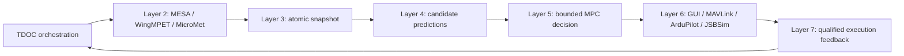

# TDDT Phoenix VTOL Navigation — GPS/GNSS-Denied Prototype

**Trans-Domain Digital Twin (TDDT)** is the architectural approach used by this research prototype to coordinate navigation, vehicle dynamics, local weather, prediction, control, physical simulation, and execution feedback for a Phoenix VTOL aircraft.

The immediate engineering objective is to close the online loop:

**Layer 2 → Layer 3 → Layer 4 → Layer 5 → Layer 6 → Layer 7 → Layer 2**, under **TDOC orchestration**, so that decisions derived from current twin states can arm the aircraft, command a mission, and land through the real ArduPilot SITL/JSBSim execution stack.

This repository contains the integrated `TDDT_integrated_fix_v4` bundle snapshot imported on **2026-11-11**: source code, three primary FMUs, the native FlightStack, datasets, existing Python environments, build products, and recorded experiment evidence. It is an experimental integration bundle. A historical Native PASS is evidence for the particular recorded mission; it is not a guarantee that every new run passes or that all original TDDT formalisms have been implemented.

## Contents

- [Project goals and current scope](#project-goals-and-current-scope)
- [Architecture and the online cycle](#architecture-and-the-online-cycle)
- [Navigation sensors and the GNSS boundary](#navigation-sensors-and-the-gnss-boundary)
- [Repository layout](#repository-layout)
- [Download the complete bundle](#download-the-complete-bundle)
- [Platform and prerequisites](#platform-and-prerequisites)
- [Setup, preparation, and build](#setup-preparation-and-build)
- [Offline training and the Online handoff](#offline-training-and-the-online-handoff)
- [Run Online navigation](#run-online-navigation)
- [Reports and recorded results](#reports-and-recorded-results)
- [Known limitations](#known-limitations)
- [Troubleshooting](#troubleshooting)
- [Rebuild and provenance rules](#rebuild-and-provenance-rules)
- [Licensing and documentation policy](#licensing-and-documentation-policy)

## Project goals and current scope

The intended system combines several domain twins rather than treating a stored route or an offline episode as the online controller. Its broader goals include GNSS-denied guidance, dynamically coupled domain models, prediction-based control, environment-aware decisions, and eventual improvement of mission cost and energy use.

The current Native profile demonstrates a narrower capability: sensor-based state reconstruction, current-state predictions, bounded candidate selection, GUI/MAVLink execution, and traceable feedback to the vehicle prediction model during VTOL translation and landing.

The selected profile is:

```yaml
tdoc:
  realtime:
    enabled: true
    profile: native-sensor-vtol-prototype-v1
```

With this selection, the canonical Online command enters the realtime implementation in [TDOC's realtime module](TDOC_v20260911_2052/src/tddt_tdoc/realtime.py). Configuration and code for other workflows are also present in the snapshot. Their existence does not mean that the current realtime mission invokes every legacy engine, optimizer, learning path, or certificate.

The recorded destination missions use VTOL translation. They do not establish a qualified transition to wing-borne cruise or execution of every phase in the broader mission formalism.

## Architecture and the online cycle

TDOC owns orchestration. It invokes the domain packages and carries versioned state, decision, execution, and feedback information between them.

| Component | Intended responsibility | Participation in the current Native profile |
| --- | --- | --- |
| Layer 1 | Physical event and observation ingress | Approved telemetry and lifecycle observations enter the integrated system. |
| Layer 2 | Domain twins | `MESA_NAV.fmu`, `WingMPET.fmu`, and `MicroMetTwin.fmu` participate in state reconstruction and prediction. |
| Layer 3 | Shared state, coupling, and dynamic network | An atomic, hashed snapshot binds the three current twin packets and declares their couplings. The complete formal Layer 3.2 network solver is not invoked in this profile. |
| Layer 4 | Prediction and feasibility | Generates a bounded neighborhood of control candidates with WingMPET-informed initial response and a reduced ArduPilot inner-loop model. |
| Layer 5 | Control decision | Selects a feasible candidate with minimum implemented cost and translates it into bounded pilot commands with the profile's runtime checks. |
| Layer 6 | Physical twin and execution gateway | Validates and executes through Phoenix GUI, MAVLink, ArduPilot SITL, and JSBSim; returns telemetry and execution evidence. |
| Layer 7 | Prediction/execution comparison | Qualifies time-matched, command-correlated residuals and returns model-only adaptation to the next Layer 2 cycle. |



A typical online cycle:

1. Reconstruct the latest MESA state from the approved sensor stream.
2. Apply the previous qualified Layer 7 update to the Wing prediction model.
3. Obtain the current MicroMet weather prediction and pass its wind/density to WingMPET.
4. Build the Layer 3 atomic snapshot.
5. Evaluate Layer 4 candidates and let Layer 5 select a new command.
6. Execute the command through Layer 6 and obtain a transaction-bound receipt.
7. Compare the original prediction with the appropriate later sensor-reconstructed state and route accepted feedback to the next cycle.

The target decision cadence is **10 Hz**. Layer 6 services latched commands at **30 Hz** with a **0.5-second command lease**. Candidate predictions cover **2 seconds**. These are distinct rates and validity intervals; they are not interchangeable guarantees of hard realtime performance.

### The three domain twins

- **MESA-NAV:** propagates the navigation state with the FMU's IMU operation and applies complementary aiding using the permitted sensor channels. Its active supplemental covariance covers position, velocity, and wind, not the complete error-state formulation of the original design.
- **WingMPET:** evaluates vehicle response using current MESA state, observed servo outputs, and current model weather. Its outputs initialize the reduced response used in the online rollouts.
- **MicroMetTwin:** evaluates bound, cached climate forcing with terrain context at the estimated location and simulation time, approximately every 0.5 seconds. Its weather output is a model prediction, not an independent wind-sensor measurement.

The current Layer 4 cost penalizes tracking error, commanded acceleration, and changes in the command. It is not a demonstrated global route optimizer or a closed-loop battery-energy optimizer.

## Navigation sensors and the GNSS boundary

The operational navigation inputs in the recorded Native missions are:

| Sensor/data | Actual role |
| --- | --- |
| Gyroscope | Attitude propagation and body-rate information |
| Accelerometer | Specific-force propagation; stationary initialization |
| Magnetometer | Initial alignment and directional attitude correction |
| Barometer | Relative vertical-state correction |
| Scalar pitot airspeed | Airspeed-envelope checks and limited wind-model correction |
| Ultrasonic wind sensor | Permitted in the architecture, but no registered operational samples in the recorded PASS profile |

The profile checks that `GPS1_TYPE`, `GPS2_TYPE`, and `SIM_GPS1_ENABLE` through `SIM_GPS4_ENABLE` are disabled. It uses sensor-only EKF3 configuration inside ArduPilot. MESA does not consume FCU position, velocity, or attitude as navigation measurements.

**Vision, optical flow, odometry, and simulator pose are not navigation aiding sources in this profile.** A surveyed mission origin initializes the coordinate frame; setting that known origin is not a live GPS fix.

`SIM_STATE` remains available for independent evaluation, the physical map display, and physical environment placement. It is separated from the MESA observation interface and the control residual path. A map showing the simulator's physical position does not mean that position is being fed back into navigation.

The magnetic reference is a coarse offline field table used at the estimated position. Local magnetic-anomaly map matching for independent position/drift correction is not active. Horizontal navigation drift is not independently observable or bounded by the present sensor integration.

## Repository layout

| Path | Contents |
| --- | --- |
| `TDOC_v20260911_2052/` | Orchestrator, configuration, preparation/training commands, handoffs, runtime state, and reports |
| `twins_layer2_v20260820_1233/` | MESA-NAV and WingMPET sources, FMUs, profiles, and Twin Epistemic Profiles |
| `climate_twin_v20260911_0922/` | MicroMet sources, FMU, preprocessing, and climate interfaces |
| `layer3_v20260911_1131/` | Shared-state/network implementation and realtime snapshot path |
| `layer4_v20260907_0608/` | Prediction, verification, and realtime candidate generation |
| `layer5_v20260911_1510/` | Decision/control implementation and knowledge-store interfaces |
| `layer6_v20261007_1032/` | Layer6Client, GUI/service, Native session management, installers, and FlightStack |
| `layer7_v20260901_0921/` | Residual qualification and model-feedback implementation |
| `boulder_multilayer_map_builder_v20260814_1215/` | Map, DEM, obstacle, and environmental-context preparation |
| `SARG_v20260821_0945/` | Scenario/reference generation and generated SARG data |
| `TDOC_ISO_Universal_Unit_Conversion_Standard20260824_0914/` | Shared unit/frame conversion interfaces |
| `internet_datasets/` | Cached external source data |
| `presentation/phoenix_mavproxy_icons/` | Original Phoenix icon assets, hashes, and the presentation installer |
| `integration_*/` | Historical investigations, source/evidence snapshots, results, and screenshots |
| `bundle_metadata/` | Transfer manifest and recoverable nested Git metadata |
| `restore_bundle_snapshot.py` | Snapshot integrity checking and optional metadata restoration |

Package directory names are part of existing addressing and validation contracts. Keep their names when reproducing the bundle.

## Download the complete bundle

**Git LFS is required for a complete download.** The initial snapshot contains approximately 19.3 GB of source-bundle file content before exclusions/repackaging effects, including installed environments and recorded evidence. Provision additional space for the checkout, Git/LFS object stores, and future builds.

```bash
git lfs install
git clone https://github.com/nn44nniri/TDDT_phoenixdrone_navigation_GPSdenied.git
cd TDDT_phoenixdrone_navigation_GPSdenied
git lfs pull
python3 restore_bundle_snapshot.py --repair-checkout
```

The import tracked files of at least **50 MiB** through LFS: **54 paths**, representing **48 unique objects** totaling approximately **7.4 GiB**. A successful Git checkout containing LFS pointer text is not a complete installation. Do not assume that downloading a GitHub source ZIP retrieves every LFS payload.

The original transfer manifest records source paths, sizes, SHA-256 values, file modes, and symlink targets. The verification helper checks direct files and the contents of the nested-Git archives. `--repair-checkout` repairs any Git line-ending normalization from the exact committed blobs; it does not replace a missing LFS download.

### Nested ArduPilot/JSBSim Git metadata

All exported source files are ordinary files in this main repository, not replacement submodule gitlinks. Because Git cannot track an internal `.git` path as an ordinary tree entry, the original nested Git metadata and submodule gitfiles are preserved in recoverable archives.

**Before rebuilding/installing the already populated FlightStack source directories**, restore this metadata so the existing installer can recognize them as checkouts:

```bash
python3 restore_bundle_snapshot.py --restore-git-metadata --repair-checkout
```

Restoration operates on your clone. The initial snapshot verification manifest describes the imported bundle; later README-only documentation commits do not change the original source-file hashes.

## Platform and prerequisites

The reference Native setup was exercised on **Debian 13**, with **CPython 3.13** environments and a working graphical desktop. Individual packages declare their own Python requirements; those declarations do not establish equivalent Native qualification on every supported Python version or operating system.

The setup uses:

- Bash, Git, Git LFS, Python and virtual-environment support.
- C/C++ build tools, Make, CMake, and ArduPilot's build/prerequisite tooling.
- The Python/GIS/FMI dependencies in the component requirements files.
- MAVProxy, wxPython, OpenCV, Pillow, and the Phoenix GUI/controller dependencies in the Native environment.
- A usable display/session for six simultaneous windows and X11 screenshot utilities for the included evidence observer.
- Internet access during fresh external-data acquisition and any installation steps that require downloads.

The included virtual environments and build artifacts preserve the reference snapshot. They are not a portable substitute for installation: interpreter symlinks, console-script shebangs, compiled extensions, and cached absolute paths may require rebuilding or repair after relocation.

## Setup, preparation, and build

The commands below consolidate the local bundle's `SETUP.md` and the current executable profile. That file was intentionally excluded from the GitHub tree by the Markdown export policy. This README supplies the main workflow without requiring it.

**Choose the appropriate workflow:** preserve an existing accepted model/prior/forcing binding for replay of that configuration, or perform a new preparation/build/training cycle. Reset is a preparation operation and deletes runtime knowledge; it is not an Online startup command.

### 1. Load the authoritative environment

From the repository root:

```bash
cd TDOC_v20260911_2052
source configs/environment_fixed.sh
```

This declares the package/data roots, source import paths, TDOC-owned runtime locations, and `$PYTHON`. Package addresses come from the environment rather than ad hoc YAML overrides.

A relocated or incompatible Python environment must be repaired or recreated for the target machine before dependency installation. Re-source this environment in each new shell.

### 2. Install the preprocessing/runtime Python requirements

```bash
"$PYTHON" -m pip install --upgrade pip setuptools wheel

"$PYTHON" -m pip install \
  -r "$TDDT_ORCHESTRATOR_ROOT/requirements.txt" \
  -r "$TDDT_BOULDER_ROOT/requirements.txt" \
  -r "$TDDT_SARG_PACKAGE_ROOT/requirements.txt" \
  -r "$TDDT_CLIMATE_ROOT/requirements.txt" \
  -r "$TDDT_LAYER3_ROOT/requirements.txt" \
  -r "$TDDT_LAYER4_ROOT/requirements.txt" \
  -r "$TDDT_LAYER5_ROOT/requirements.txt" \
  -r "$TDDT_LAYER7_ROOT/requirements.txt"
```

The combined requirements transaction lets the resolver consider these packages together. Native FlightStack/GUI dependencies are handled by the FlightStack installation path as well.

### 3. Install or repair the Native FlightStack

For a full installation, supply the installation assets and use the wrapper that also installs the Phoenix map artwork:

```bash
export TDDT_FLIGHTSTACK_ASSETS=/absolute/path/to/flightstack-installation-assets

bash "$TDDT_LAYER6_ROOT/scripts/install_flightstack_with_phoenix_icons.sh" \
  --base-dir "$TDDT_LAYER6_ROOT" \
  --assets-dir "$TDDT_FLIGHTSTACK_ASSETS"
```

The standard installer recognizes these canonical asset names, with some version-pattern alternatives:

```text
install-prereqs-debian13-pexpect-fix-v2.tar.gz
phoenix_v3_jsbsim_model_v4.tar.gz
phoenix_environment_adapter_v2.tar.gz
phoenix_f310_controller_v6.tar.gz
internet_datasets.tar.gz
region_v1.geojson
```

These are installer inputs. Do not assume an `essential_data/` directory exists or that every required archive is colocated in the exported tree. The installer checks its asset inputs and preserves an already recognized source checkout.

A compatible existing FlightStack does not need a full reinstall before every Online run. Check its map dependencies with:

```bash
bash "$TDDT_LAYER6_ROOT/scripts/install_flightstack_rev1.sh" \
  --base-dir "$TDDT_LAYER6_ROOT" --check-replay-map
```

For source/model repair and the standard ArduPlane rebuild path, before producing a new compatible prior:

```bash
bash "$TDDT_LAYER6_ROOT/scripts/install_flightstack_rev1.sh" \
  --base-dir "$TDDT_LAYER6_ROOT" --repair-model-only
```

This is a build/repair operation, not a flight-readiness certificate.

### 4. Prepare external data and build the three primary FMUs

For a **new preparation cycle**, from TDOC:

```bash
cd "$TDDT_ORCHESTRATOR_ROOT"

"$PYTHON" -m tddt_tdoc.cli --config configs/tdoc.yaml reset \
  --refresh-external \
  --climate-hours 24 \
  --build-fmus \
  --build-fmus-refresh
```

To rebuild generated products from existing cached downloads without downloading those source datasets again:

```bash
"$PYTHON" -m tddt_tdoc.cli --config configs/tdoc.yaml reset \
  --refresh-external \
  --reuse-downloaded-datasets \
  --climate-hours 24 \
  --build-fmus \
  --build-fmus-refresh
```

The cache must contain the required inputs and valid time coverage; reuse is not permission to substitute unavailable or expired forcing.

Preparation covers maps/DEM, OSM or obstacle inputs, climate forcing, CRP, SARG, and Twin Epistemic Profiles. [`scripts/prepare_all.sh`](TDOC_v20260911_2052/scripts/prepare_all.sh) is the orchestrated preparation entrypoint used for this chain; reset with `--refresh-external` invokes the preparation workflow. The build flags reconstruct `MESA_NAV.fmu`, `WingMPET.fmu`, and `MicroMetTwin.fmu`.

### 5. Run preflight

```bash
"$PYTHON" -m tddt_tdoc.cli --config configs/tdoc.yaml preflight
```

Preflight checks package roots, required artifacts, datasets, and contracts it can inspect. Passing preflight does not certify a new flight or guarantee that the archived Offline knowledge is valid for a newly rebuilt model.

## Offline training and the Online handoff

The standard intended Offline workflow is a stateful mission from the origin toward touchdown:

```bash
"$TDDT_ORCHESTRATOR_ROOT/scripts/run_training_workflows.sh" --offline
```

Its control route is **Layer 2 → Layer 3 → Layer 4 → Layer 5 → TDOC → Layer 2**. Layer 6 physical execution is outside this Offline training loop. Outputs include Single-Episode experience, SS-KStore/SETD artifacts, and the finalized handoff used by Online readiness.

The handoff is typically under:

```text
TDOC_v20260911_2052/runtime/knowledge/handoff/offline_latest.json.gz
```

### CRP, SARG, TEP, and learned experience

| Artifact | Architectural purpose | Actual current Native participation |
| --- | --- | --- |
| CRP | Environmental/topographic context descriptions and classification | Offline context metadata exists; per-cycle Online CRP classification/selection is not active in the current realtime controller. |
| SARG | Scenario/reference and mission guidance | An existing Offline mission reference is inspected during preparation; the realtime mission constructs its current reference from its mission target and phase logic rather than replaying Offline commands. |
| TEP | Twin experience, validity, uncertainty, quality, and novelty support | Profiles are loaded with domain wrappers, but direct FMU operations in the realtime loop bypass the wrapper's full TEP lookup/packet-scoring path. |
| SETD/KStore and handoff | Versioned experience and compatibility/provenance | Used primarily for integrity, model-identity eligibility, and preparation. Effective learned candidate/policy warm-start in the realtime MPC has not been demonstrated. |

**The archived Native PASS used a partial, finalized prior produced by a three-cycle diagnostic Offline run. It did not establish completed Offline training through touchdown.** Its accepted scope was `MODEL_IDENTITY_ONLY`, with no inherited flight authority or replacement of current state. The standard full-training command above describes the intended workflow; the archived partial prior must not be presented as evidence that the full workflow completed.

After accepting a handoff for Online, preserve its source/model identity, KStore, forcing file, and climate-time binding. **Do not reset, refresh external data, clear KStore, alter climate forcing, or relabel certificates between accepted Offline preparation and Online reuse.** A changed model or forcing requires a new compatible qualification/training cycle.

## Run Online navigation

From the TDOC directory, after loading the environment and obtaining a compatible accepted prior:

```bash
"$PYTHON" -m tddt_tdoc.cli \
  --config configs/tdoc.yaml \
  nav-online \
  --reuse-existing-offline-knowledge \
  --online-episodes 1 \
  --online-max-cycles-per-episode-auto
```

The current configuration selects the realtime VTOL profile. Startup establishes the Native session, checks required parameter readbacks and panel health, and performs the configured **60-second stationary, disarmed sensor calibration** before normal ARM.

The route profile uses approximately **10 m above the launch reference** and a **6 m/s horizontal reference speed**. That altitude is not terrain-following clearance over the DEM.

The destination mission's operational sequence is:

```text
on-ground preparation → normal ARM → vertical_takeoff → cruise_vtol
→ vertical_landing → landing_flare → contact_settle → normal DISARM
```

These names describe the current prototype's sequence, not certification of the entire theoretical flight envelope.

### Six simultaneous Native windows

All six must be alive and observing the same Native session:

1. ArduPilot SITL.
2. JSBSim Native backend observer.
3. Environment Adapter.
4. Phoenix GUI.
5. MAVProxy Map.
6. MAVProxy Console.

The JSBSim window observes the ArduPilot-owned JSBSim backend; it does not launch another physical simulator. Panel/process presence alone is insufficient: the evidence includes session identity, fresh telemetry, ARM/MODE, physical-map updates, and screenshots.

The execution route is:

```text
Layer 5 decision
  → Layer6Client validation / semantic pilot-command translation
  → command latch and rate adaptation
  → Phoenix GUI
  → MAVLink
  → ArduPilot SITL
  → JSBSim
  → telemetry / execution receipt
  → Layer 7
```

[`Layer6Client`](layer6_v20261007_1032/src/layer6/client.py) is the public client interface. `submit()` accepts the fuller decision envelope; `submit_command()` supplies a simpler pilot command. In this Native profile, `u_cmd=[aileron,elevator,throttle,rudder]` is a pilot-domain command, not a direct motor/PWM vector.

Manual/gamepad control is a separate operating mode. Do not introduce a second flight-command owner during a TDOC-controlled mission.

### Optional local commissioning target

A local takeoff/hover/landing objective can be requested explicitly:

```bash
"$PYTHON" -m tddt_tdoc.cli --config configs/tdoc.yaml nav-online \
  --reuse-existing-offline-knowledge \
  --online-episodes 1 \
  --online-max-cycles-per-episode-auto \
  --online-local-hover-seconds 5 \
  --online-local-hover-height-m 3
```

This changes the mission objective. It is a diagnostic hover test, not a substitute for destination-route qualification.

### Phoenix icons on the MAVProxy map

The full installation wrapper installs the five supplied Phoenix colors. On an existing compatible stack, install or verify only this presentation patch:

```bash
bash "$TDDT_LAYER6_ROOT/scripts/install_flightstack_with_phoenix_icons.sh" \
  --base-dir "$TDDT_LAYER6_ROOT" --icons-only

bash "$TDDT_LAYER6_ROOT/scripts/install_flightstack_with_phoenix_icons.sh" \
  --base-dir "$TDDT_LAYER6_ROOT" --check-icons
```

The patch maps aircraft icon aliases to the original Phoenix PNGs in the bundle's Native MAVProxy environment and corrects the relocated MAVProxy launcher's Python shebang. It does not modify flight-control source or dynamics. Reapply it after reinstalling/upgrading MAVProxy. The source artwork and hashes are preserved in [`presentation/phoenix_mavproxy_icons/`](presentation/phoenix_mavproxy_icons).

## Reports and recorded results

### Automatically generate rich reports after Online

Use the reporting wrapper:

```bash
"$PYTHON" scripts/run_online_with_reports.py --config configs/tdoc.yaml
```

It launches the same canonical Native command, records same-session window evidence, compares model/prior/forcing identity before and after the run, and generates the reports after execution.

**The plain canonical command does not automatically invoke this additional rich-reporting wrapper.** Use the wrapper above when these outputs are required.

```text
TDOC_v20260911_2052/reports/online/
  INDEX.html
  latest  -> runs/<run-id>/
  mission -> runs/<run-id>/mission/
  evidence -> runs/<run-id>/evidence/
  runs/<run-id>/
    evidence/
      native/{startup.json,cycles.jsonl,telemetry_wire.jsonl,MISSION_RESULT.json}
      windows/{screenshots,manifests,native_observations.jsonl}
      native_session/{binding and archived session logs}
      preservation*.json
    mission/
      MISSION_MANAGEMENT_DASHBOARD.html
      MISSION_ROUTE_3D.html
      LANDING_ENERGY_TIME_REPORT.html
      LAYER3_DYNAMIC_NETWORK_REPORT.html
      NATIVE_QUALIFICATION.json
      ...HTML, CSV, JSON, and compressed evidence...
```

The report set includes terrain and phase-aware Plotly 3D routes, weather/wind display, landing accuracy, time and telemetry energy, decision/candidate details, Layer 3/3.2 coverage, Layer 7 feedback, and Native execution evidence. Unrecorded quantities remain unavailable rather than being silently reported as zero.

The 3D terrain surface is display context; its presence is not evidence that JSBSim's contact surface follows the same DEM.

Download or open HTML reports locally in a browser; GitHub's source view does not run the dashboards. A local server can be used from TDOC:

```bash
"$PYTHON" -m http.server 8000 --bind 127.0.0.1 --directory reports/online
```

Then open `http://127.0.0.1:8000/`. Plotly 3D views require a browser with working WebGL.

### Rebuild reports from archived evidence without flying

From TDOC, for example:

```bash
"$PYTHON" scripts/report_online_realtime.py \
  --config configs/tdoc.yaml \
  --source-dir reports/online/runs/20261106_092359_103f0383/evidence/native \
  --evidence-dir reports/online/runs/20261106_092359_103f0383/evidence \
  --output-dir reports/online/runs/20261106_092359_103f0383/mission
```

This is reporting only. Reconstructing bound terrain/environment context requires the original compatible inputs to be accessible; a relocated missing source must not be replaced with unrelated data and called the same experiment.

### Preserved destination-mission evidence

Both runs below use the approximately **2,385.231 m** original route and the same recorded model identity.

| Run | Recorded result | Control interval | Physical goal error | Cycles |
| --- | --- | --- | --- | --- |
| [20261105_095929_eac3f73b](TDOC_v20260911_2052/reports/online/runs/20261105_095929_eac3f73b/mission/NATIVE_QUALIFICATION.json) | PASS | 445.08 s | 7.27 m | 4,458 |
| [20261106_092359_103f0383](TDOC_v20260911_2052/reports/online/runs/20261106_092359_103f0383/mission/NATIVE_QUALIFICATION.json) | FAIL | 444.78 s | 31.62 m | 4,455 |

The later run completed takeoff, landing, and DISARM, and the Phoenix map artwork was observed correctly. Its endpoint error exceeded the unchanged **25 m** mission tolerance, so it remains a failed mission. The repository preserves both results.

The recorded model identity is:

```text
14e38c50ad391ce77e80c1bd316c7785438e61b7afa3ba5062541fae8999c73c
```

A model hash identifies artifacts; it is not a proof of aerodynamic accuracy, navigation observability, or repeatable mission success.

## Known limitations

| Area | Current limitation and interpretation |
| --- | --- |
| Layer 3.2 | The Native loop uses `atomic_snapshot`, not the complete `Layer3Engine.plan_network/step` execution. Full network weights, numeric coupling strengths, CoC/mismatch, consistency-region, emergence, and hidden-loop metrics are not produced by that solver in the current mission. |
| Navigation drift | Horizontal position is propagated without an independent horizontal position observation. Magnetic directional aiding and scalar pitot do not establish independent position-drift correction. |
| Uncertainty | The supplemental covariance is not the full original MESA formulation and is not fully used to tighten MPC constraints. |
| Sensor robustness | `SIM_DRIFT_SPEED=0` disables the artificial gyro-bias ramp; base random noise remains. Robustness to realistic time-varying bias and magnetic disturbances is not established. |
| Offline experience | The documented prior is partial and primarily supplies compatibility eligibility; learned policy/candidate warm-start is not established in the Native decision path. |
| Energy optimization | Battery telemetry is not consumed by the current MPC energy/feasibility logic; WingMPET receives `soc=1.0` each cycle. Low command cost is not a demonstrated minimum-energy route. |
| Battery sufficiency | The profile defines a 3S, 2.2 Ah battery: 24.42 Wh nominal and 20.5 Wh usable. The later run reports approximately 58.52 Wh from SITL telemetry versus 9.75 Wh from WingMPET; remaining-charge telemetry reaches zero while the simulated mission continues. These models are not reconciled or calibrated hardware measurements. |
| Energy savings | No matched baseline establishes a savings percentage. The difference between the two energy models is not energy saved. |
| Ground/terrain | Initial geometry places the feet on the simulator surface with the CG approximately 0.141 m above it. Contact and DISARM evidence exist, but the contact surface is not validated against the route DEM. The later endpoint's displayed physical-altitude/DEM difference is approximately 162.8 m; that is a model/reference mismatch, not a certified real-ground clearance. |
| Environment | WingMPET receives model 3D wind and density; Native environment application is verified for horizontal wind parameters only. |
| Flight envelope | The recorded profile does not qualify wing-borne transition, all theoretical phases, global stability, obstacle avoidance, or full recovery behavior. |
| Validation | A few recorded successes and failures do not establish statistical reliability, hardware readiness, or complete realization of the original formalisms. |

Treat mission status, navigation accuracy, energy feasibility, and architectural coverage as separate questions. Opening panels, reaching ARM, or producing a visually convincing route does not establish all four.

## Troubleshooting

| Symptom | First checks |
| --- | --- |
| Large files contain pointer text or verification reports missing payloads | Install Git LFS, run `git lfs pull`, and rerun the snapshot verification helper. |
| FlightStack installer says a populated destination is not a Git checkout | Restore the archived nested metadata before invoking the installer on the populated source directories. |
| Imports resolve to an older installation | Re-source `configs/environment_fixed.sh`; check its exported roots, `$PYTHON`, and source import paths. |
| GUI/MAVProxy or a compiled Python dependency fails after relocation | Repair the target-machine Native environment and launcher paths; copied virtual environments are not inherently relocatable. |
| A required Native panel is missing or stale | Check display access, the same-session process logs, Map/Console health, and required dependencies. Do not label the Online test PASS. |
| Online refuses the Offline prior | Inspect handoff, SETD, model hashes, forcing identity, and clock binding. Generate compatible new evidence when required; do not edit hashes to bypass the gate. |
| Cached climate data is rejected | Check the accepted epoch and forcing coverage; do not silently clamp, repeat, or rebase it. |
| Map position looks correct but navigation error grows | The physical display and MESA navigation are separate paths. Inspect estimated-versus-physical error, not just the green icon. |
| Report says battery remaining is zero although flight continues | This is an unresolved simulator energy-model limitation, not evidence that the configured battery can complete the mission. |

Raw cycle records, Native session logs, parameter readbacks, window manifests, and independent qualification JSON are the primary diagnostic evidence.

## Rebuild and provenance rules

Changes to compiled sources—FMUs, C/C++, ArduPilot, JSBSim, or other binaries—must be made in their source/build process, followed by a rebuild and a test of the resulting artifact. A patched binary alone is not a durable fix.

The FMU build/packaging scripts and the FlightStack installer/model generators are the standard reconstruction paths. Verify deployed and embedded source identity, record hashes and build evidence, and qualify new Offline/Online artifacts when identity changes.

Python/configuration changes covered by the model dependency contract can also invalidate a prior even without a C++ rebuild. Preserve historical results as historical evidence instead of assigning their PASS status to a changed model.

The snapshot export itself did not change control sources, FMUs, model binaries, forcing, or KStore. Updating this README is documentation maintenance; it does not run installation, reset, training, or a flight.

## Licensing and documentation policy

Third-party license files and notices remain in their original component paths. ArduPilot, JSBSim, and the included libraries retain their respective licenses; aggregating them here does not impose one new license on the entire bundle.

The repository intentionally omits source-bundle Markdown files whose basename is not exactly `README.md`. Existing archives and archived Git history were not rewritten, and some component READMEs may refer to documents excluded by that policy. This root README therefore consolidates the essential setup and interpretation needed to understand the exported prototype.

Snapshot provenance is recorded in [`bundle_metadata/SNAPSHOT_MANIFEST.json`](bundle_metadata/SNAPSHOT_MANIFEST.json). The source-bundle inventory is also summarized in [`MANIFEST.json`](MANIFEST.json) and [`PROVENANCE_POLICY.json`](PROVENANCE_POLICY.json).
